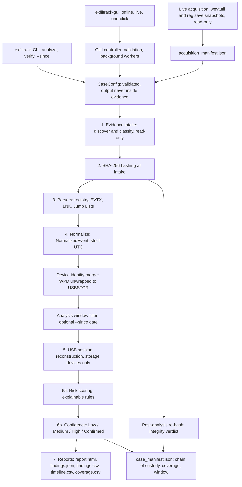
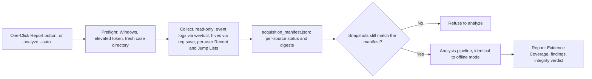
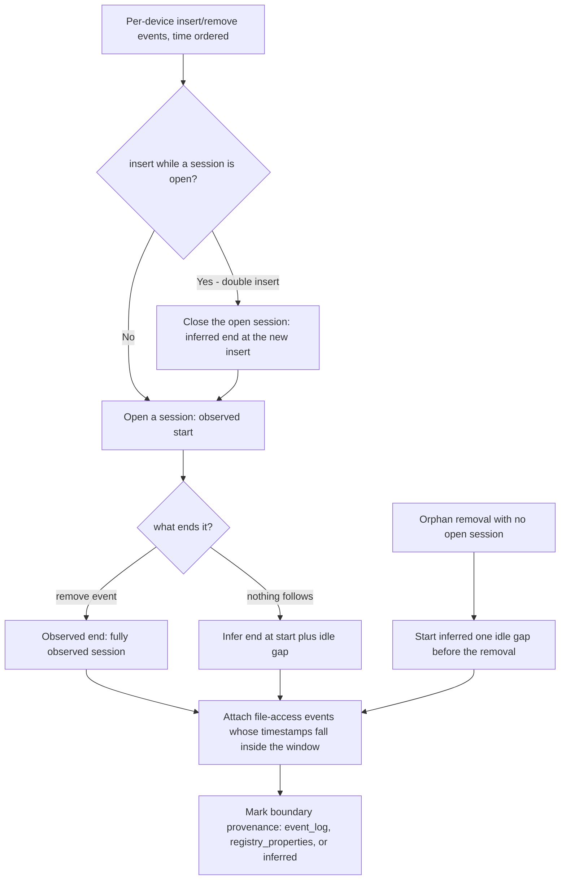
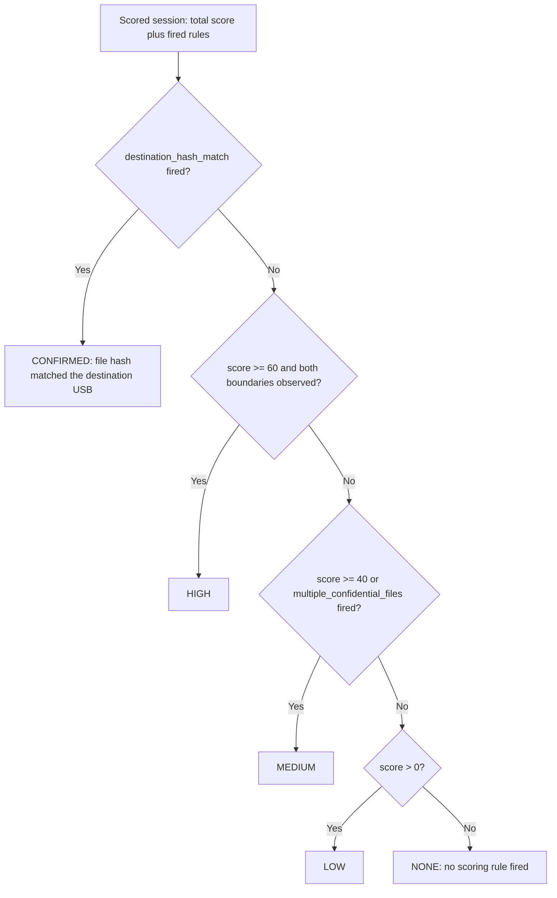
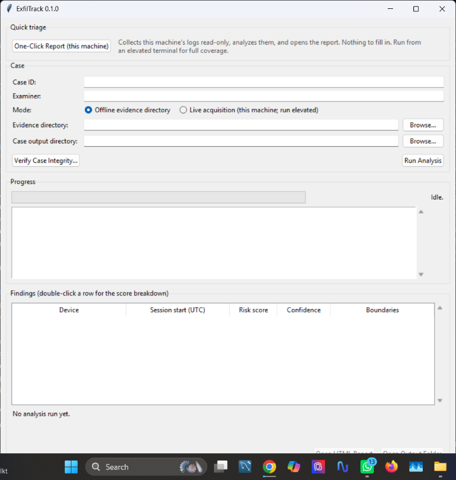
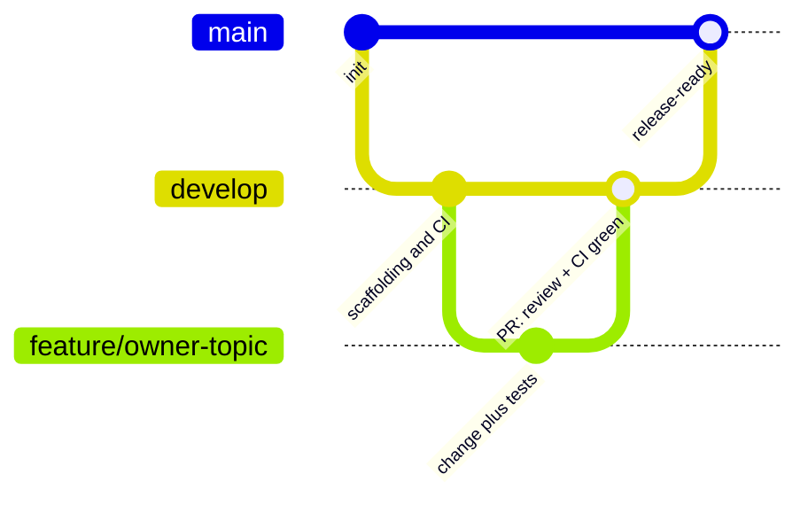

# ExfilTrack — Final Project Report

**A Forensically Sound USB Exfiltration Triage Tool**

| | |
| --- | --- |
| Repository | [github.com/ExfilTrack/Exfiltrack](https://github.com/ExfilTrack/Exfiltrack) |
| Version | 0.1.0 (develop @ `7e6390e`) |
| Team | Milindu Weerawarna (230699E, Project Lead) · Thabrew D. C. L. (230631P) · Dabarera G. D. M. (Maheesha) (230111X) |
| Date | October 2026 |

> ExfilTrack identifies activity consistent with possible USB-based data exfiltration. Temporal correlation alone does not prove that a file was copied.

---

## 1. Executive Summary

Departing employees with legitimate access can copy proprietary data to a personal USB device without any malware or network intrusion, and Windows records the evidence passively — but it is scattered across the Registry, event logs, shortcut files, and Jump Lists. ExfilTrack automates the collection, normalization, and correlation of those artifacts into a single evidence-backed timeline, and reports its findings as calibrated risk scores and confidence levels rather than accusations.

The delivered tool provides:

- An **offline pipeline** that ingests exported artifacts read-only and produces a defensible case (HTML/JSON/CSV reports plus a chain-of-custody manifest with SHA-256 integrity proof).
- **Live acquisition** (`--auto`): one command collects the relevant artifacts from a running Windows machine — never enabling or changing logging — and analyzes the snapshots.
- A **desktop GUI** (tkinter, zero new dependencies) with offline and live modes, a one-click collect-and-report button, real percentage progress, an analysis-window date filter, and digest verification.
- **Evaluation** on synthetic controlled scenarios, on an automated test suite (461 tests, CI on Python 3.10–3.12), and on **public real-world EVTX datasets** downloaded from the internet (Section 9.3).

## 2. Problem Statement and Objectives

**Problem.** A company-issued laptop holds proprietary source code and client data. An insider copies it to a USB stick before leaving. No DLP is installed. The investigator must reconstruct what happened from artifacts Windows recorded incidentally — a slow, error-prone, inconsistent manual process.

**Objectives (met).**

1. Collect and read the four artifact classes without ever modifying them.
2. Normalize everything into one UTC timeline with per-record provenance.
3. Reconstruct probable USB connection sessions and attach file activity to them.
4. Score risk with an explainable rule model and express calibrated confidence — never a bare accusation.
5. Generate a report a non-technical manager can read and a reviewer can defend.
6. Prove forensic soundness: integrity digests before/after, deterministic output, explicit errors.

## 3. Forensic Soundness Requirements

These seven non-negotiables drove every design decision and are enforced in code, not convention:

1. **Evidence is never modified** — all evidence opened strictly read-only.
2. **Output is isolated** — analysis output goes to a separate case directory; the configuration layer refuses output-inside-evidence.
3. **Integrity is proven** — SHA-256 digests computed before and after analysis; a mismatch is a hard failure.
4. **Findings are traceable** — every finding cites its source artifact; every parser records name and version.
5. **Timestamps are preserved** — original raw values are kept beside the UTC-normalized ones.
6. **Errors are explicit** — malformed evidence produces a reported error, never a silent skip.
7. **Runs are reproducible** — same evidence + same tool version → byte-identical output (verified by test).

## 4. System Architecture

ExfilTrack is an offline, staged pipeline: each stage consumes only the previous stage's output, which keeps parsers independent of scoring logic and makes every stage independently testable. The CLI, the GUI, and the live collector all converge on the same `run_pipeline` entry point, so behaviour cannot diverge between front ends.

**Figure 1 — System architecture and data flow** (also in [`diagrams/pipeline-architecture.mmd`](diagrams/pipeline-architecture.mmd)):



The single shared contract between parsers and correlation is the `NormalizedEvent`: `event_type`, `timestamp_utc` (aware UTC), `raw_timestamp` (untouched original), `source_artifact`, `parser_name`, `parser_version`, and optional `device` / `file_path` / `file_size_bytes` / `details`. That boundary is what allowed the four parsers and the scoring engine to be built in parallel by different team members.

## 5. Evidence Sources and Acquisition

| Source | Artifacts | What it provides |
| --- | --- | --- |
| Registry hives | `SYSTEM`, `SOFTWARE`, `NTUSER.DAT` | USB storage device identity, vendor/product/serial, most-recent connection times (properties `0066`/`0067`), user volume mounts |
| Event logs | `System.evtx`, `Security.evtx`, DriverFrameworks-UserMode Operational | Device insert/remove boundaries (2003/2102), install events, file-access records (4663, when auditing is configured) |
| Shortcuts | `*.lnk` | Recently opened target paths, sizes, timestamps |
| Jump Lists | `*.automaticDestinations-ms`, `*.customDestinations-ms` | Per-application recent/frequent documents |

Two acquisition paths feed the identical pipeline:

- **Offline** — the investigator exports artifacts per `docs/evidence-sources.md` §6 and points the tool at the directory.
- **Live (`--auto` / GUI One-Click)** — from an elevated terminal, ExfilTrack collects the artifacts itself with `wevtutil` and `reg save` and read-only file copies, records per-source status and digests in `acquisition_manifest.json`, refuses to analyze snapshots that no longer match it, and reports collection gaps as Evidence Coverage. It never enables, clears, or changes logging.

**Figure 4 — Live acquisition and one-click flow** (also in [`diagrams/live-acquisition.mmd`](diagrams/live-acquisition.mmd)):



## 6. Correlation Engine

### 6.1 Session reconstruction

Per device, insert/remove events are paired into probable connection windows, with the two anomalies real evidence produces handled explicitly: a second insert with no intervening removal closes the previous session at the new insert (the last moment the connection was certainly active), and an orphan removal opens a session one idle-gap before it rather than inventing a connection time. File-access events are attached to every session whose window contains them — a file inside two overlapping sessions is attached to both, since the tool cannot know which device it belongs to and silently picking one would misrepresent the evidence.

**Figure 2 — Session reconstruction rules** (also in [`diagrams/session-reconstruction.mmd`](diagrams/session-reconstruction.mmd)):



### 6.2 Risk scoring

Explainable, rule-based, calibrated against the controlled scenarios (Section 9.2). Every contribution names its rule and cites its source artifact, so a score can be re-derived line by line.

| Rule | Indicator | Points |
| --- | --- | --- |
| `activity_within_30s` | File access within 30 s of session start | +25 |
| `activity_within_5min` | File access within 5 min (does not stack with the 30 s rule) | +15 |
| `sensitive_extension` | `.sql`, `.pem`, `.env`, `.zip` by default | +15 |
| `protected_directory` | Path under a configured protected directory | +20 |
| `multiple_confidential_files` | ≥ 2 distinct confidential files in one session (once per session) | +15 |
| `destination_hash_match` | File SHA-256 matches a file on the destination USB | +50 |

### 6.3 Confidence levels

`Confirmed` is reachable only through a cryptographic hash match — never by score alone. `High` additionally requires both session boundaries to be observed in the event log rather than inferred.

**Figure 3 — Confidence evaluation** (also in [`diagrams/confidence-evaluation.mmd`](diagrams/confidence-evaluation.mmd)):



### 6.4 Honesty features shipped late in the cycle

- **Evidence Coverage** (#34): every report records, per expected source, whether it was present, absent, or supplied-but-empty, with the likely configuration cause — so a clean report from an unconfigured endpoint can no longer read as an exoneration.
- **Partial-coverage marker** (#35): sessions bounded by registry `0066`/`0067` properties (most-recent-only values) or by inference are flagged next to their confidence level. The confidence ceiling is deliberately *not* capped — the decision and rationale are recorded in `docs/scoring-model.md`.
- **Device identity normalization** (#70): the DriverFrameworks log wraps USB devices in the WPD enumerator (`SWD\WPDBUSENUM\...`); these are unwrapped, canonicalized, and merged with the registry identity so one physical stick appears once, under its friendly name, with raw ids preserved for provenance. Non-storage device entries never form sessions.
- **Analysis window** (#68): an optional cutoff date (e.g. the laptop handover date) restricts analysis to events on/after it; the cutoff and the excluded-event count are disclosed in the manifest and report.

## 7. Reporting

Every run writes, into an isolated case directory:

| Output | Content |
| --- | --- |
| `report.html` | Self-contained investigator report: executive summary, per-session findings with line-by-line score breakdowns, confidence reasons, evidence coverage, chain of custody, limitations |
| `findings.json` | The full machine-readable finding set with the embedded manifest |
| `findings.csv` / `timeline.csv` | Flat findings table and the reconstructed timeline for spreadsheets |
| `coverage.csv` | Per-source evidence coverage table |
| `case_manifest.json` | Case ID, examiner, tool version, parser versions, intake and post-analysis SHA-256 digests, integrity verdict, coverage, analysis window |

Wording is enforced by a renderer-level guard: the mandated statement ("consistent with possible exfiltration… temporal correlation alone does not prove that a file was copied") must be present, and phrases like "proved" or "confirmed theft" fail the build. `exfiltrack verify --case-dir` re-checks every recorded digest later — a chain-of-custody control independent of the analysis run.

## 8. User Interfaces

**CLI** — `analyze` (offline `--evidence` or live `--auto`, optional `--since`), `verify`, `version`. Domain errors are one-line messages with exit code 1, never tracebacks.

**GUI** — `exfiltrack-gui` (tkinter, standard library only; a standalone Windows build is configured via `ExfilTrack.spec`). Case form with offline/live modes, a One-Click Report button that collects, analyzes, and opens the report by itself, a real percentage progress bar driven by pipeline stage callbacks, the analysis-window date field, a findings table with double-click score breakdowns, and case verification. The pipeline runs on worker threads; widgets are only touched on the main thread.



## 9. Testing and Evaluation

### 9.1 Automated testing

- **461 automated tests** (unit + integration) pass on `develop` @ `7e6390e`, executed by CI on Python 3.10, 3.11, and 3.12 alongside `ruff`, `black`, and `mypy` gates on every push and PR.
- Integration tests run the four controlled scenarios end to end; reproducibility tests prove byte-identical output across repeated runs, and integrity tests independently re-hash evidence after a full analysis.
- Parsers are exercised against hand-built synthetic fixtures (malformed, truncated, and adversarial inputs included — e.g. filenames with unprintable Unicode) with explicit-error assertions.

### 9.2 Controlled scenarios

Run through `tests/integration/test_scenarios.py` (recorded in `docs/scoring-model.md`):

| Scenario | Evidence | Result | Verdict |
| --- | --- | --- | --- |
| 1. Normal, non-suspicious USB use | Insertion, ordinary file opened ~2 h later, removal | 1 session, confidence below High | No false positive |
| 2. Simulated theft of synthetic confidential files | Insertion, two confidential files (`.sql`, `.pem`) within 12 s | Score 95, confidence **High** | Detected as expected |
| 3. Archive staging and deletion | `.zip` written +10 s, deleted +3 min | Score 70, confidence **High** | Detected as expected |
| 4. Unrelated recent-file activity, no USB copy | File access with no device events | 0 sessions, 0 findings | No accusation possible |

### 9.3 Public real-world datasets (downloaded from the internet)

To move beyond synthetic fixtures, the pipeline was run against curated copies of two public EVTX datasets, organized into ExfilTrack's evidence layout under `public_datasets/test_evidence_suite/` (originals unmodified; provenance recorded in `public_datasets/public-datasets-links.txt`):

- [hayabusa-sample-evtx](https://github.com/Yamato-Security/hayabusa-sample-evtx) — Yamato Security
- [evtx-attack-samples](https://github.com/sbousseaden/evtx-attack-samples) — Samir Bousseaden

The automated runner (`scripts/run_public_dataset_tests.py`) executes `analyze` and `verify` per case through the real CLI. Measured results (this repository, tool v0.1.0):

| Case | Source log | Artifacts | Events | Sessions | Findings | Analyze | Verify |
| --- | --- | --- | --- | --- | --- | --- | --- |
| 01 Credential access | evtx-attack-samples: `CA_chrome_firefox_opera_4663.evtx` | 1 | 4 | 0 | 0 | PASS | PASS |
| 02 APT28 file stealer | hayabusa: `APT28-CredentialStealer.evtx` | 1 | 2 | 0 | 0 | PASS | PASS |
| 03 System activity | hayabusa: `metasploit-psexec-powershell-target-system.evtx` | 1 | 0 | 0 | 0 | PASS | PASS |
| 04 Defense evasion | evtx-attack-samples: `DE_1102_security_log_cleared.evtx` | 1 | 0 | 0 | 0 | PASS | PASS |
| 05 Combined USB exfil | DFU + Security 4663 logs with registry hives and an `.lnk` | 6 | 23 | 2 | 2 (both None) | PASS | PASS |

Read of the results: cases 01–04 prove the parsers extract genuine Security 4663 / System events from real-world logs without crashes, and correctly produce no USB findings where no USB evidence exists (no false positives on attack-but-not-USB data). Case 05 proves the full multi-source pipeline end to end; its two sessions scored confidence **None** — the correct, defensible outcome, because the case splices logs from unrelated real captures whose timestamps do not temporally correlate. A tool that cried wolf here would fail its own calibration rules.

### 9.4 Reproducibility and integrity

Two runs over identical evidence and configuration produce byte-identical `case_manifest.json`, `report.html`, and CSV outputs (asserted by test). Evidence digests are re-hashed after analysis and independently re-verified; a mismatch is a hard failure.

## 10. Limitations

The headline ones (full detail in `docs/limitations.md`, and surfaced to users via Evidence Coverage and the partial-coverage marker):

- The DriverFrameworks channel is **disabled by default** and Security 4663 exists only with object-access auditing plus a SACL — both must be configured *before* the incident (`docs/organizational-prerequisites.md` ships a verification script and hardening checklist).
- Registry `0066`/`0067` properties record only the **most recent** connection and are overwritten each time; `.lnk`, Jump Lists, and `MountPoints2` are deletable by a standard user with no admin rights.
- Temporal correlation shows activity *consistent with* possible exfiltration; it never proves a file was copied. Only a destination hash match (`Confirmed`) demonstrates presence on the destination device.
- Live collection is not an atomic snapshot and creates activity on the machine; the integrity verdict covers the collected snapshots, not the live system.

## 11. Ethical Use

ExfilTrack analyzes artifacts that may include personal file names and device history. It is built for authorized investigators on company-owned equipment within a defined incident-response process, governed by organizational policy and applicable law — not for covert or unauthorized surveillance.

## 12. Development Process

Trunk-based flow with protected branches: `main` (release-ready) ← `develop` (integration) ← owner-prefixed feature branches. Every change: an issue with a Definition of Done, a Conventional-Commits branch, a PR with a filled template, CI green, and at least one approving review. Work was tracked as milestones (artifact collection → correlation → reporting → testing → final release) and issues #1–#70.

**Figure 5 — Branching workflow** (also in [`diagrams/development-workflow.mmd`](diagrams/development-workflow.mmd)):



## 13. Task Allocation

| Member | Responsibilities |
| --- | --- |
| Milindu Weerawarna (230699E, Project Lead) | Evidence intake, hashing and manifest, registry parser, live acquisition, CLI, configuration, architecture docs, coordination |
| Thabrew D. C. L. (230631P) | EVTX, LNK, and Jump List parsers, event model and timestamps, evidence-source documentation, public-dataset testing |
| Dabarera G. D. M. (Maheesha) (230111X) | Correlation engine, risk scoring, confidence model, reports (HTML/JSON/CSV), evidence coverage, GUI, user guide |

All members contributed jointly to testing, documentation, and the demonstration.

## 14. Conclusion

ExfilTrack delivers the proposal's goal: a forensically sound, offline triage pipeline that turns scattered Windows artifacts into an explainable, evidence-backed investigative timeline — with the honesty mechanisms (coverage reporting, partial-coverage markers, calibrated confidence, mandated wording) that make its output defensible rather than merely plausible. The evaluation shows the pipeline detects the simulated-theft scenarios at High confidence, stays silent on non-USB activity in real attack logs from public datasets, never crashes on malformed input, and produces byte-identical, integrity-verified output on repeat runs.

## Appendix A — Running the Tool

```bash
pip install -e .
exfiltrack analyze --evidence ./evidence --case-dir ./cases/CASE-001 --case-id CASE-001 --examiner "Name" [--since YYYY-MM-DD]
exfiltrack analyze --auto --case-dir D:\Cases\CASE-002 --case-id CASE-002 --examiner "Name"   # elevated
exfiltrack verify --case-dir ./cases/CASE-001
exfiltrack-gui        # desktop GUI
```

## Appendix B — Diagram Sources

All figures are Mermaid, embedded inline above (rendered natively on GitHub) and mirrored as standalone files under [`docs/diagrams/`](diagrams/); pre-rendered SVG versions (validated with mermaid-cli) are under [`docs/images/`](images/) for submission formats that need static images:

| Figure | Mermaid source | Pre-rendered SVG |
| --- | --- | --- |
| 1. System architecture | `diagrams/pipeline-architecture.mmd` | `images/pipeline-architecture.svg` |
| 2. Session reconstruction rules | `diagrams/session-reconstruction.mmd` | `images/session-reconstruction.svg` |
| 3. Confidence evaluation | `diagrams/confidence-evaluation.mmd` | `images/confidence-evaluation.svg` |
| 4. Live acquisition flow | `diagrams/live-acquisition.mmd` | `images/live-acquisition.svg` |
| 5. Branching workflow | `diagrams/development-workflow.mmd` | `images/development-workflow.svg` |

Further reading: `docs/architecture.md`, `docs/evidence-sources.md`, `docs/scoring-model.md`, `docs/limitations.md`, `docs/user-guide.md`, `docs/organizational-prerequisites.md`.


